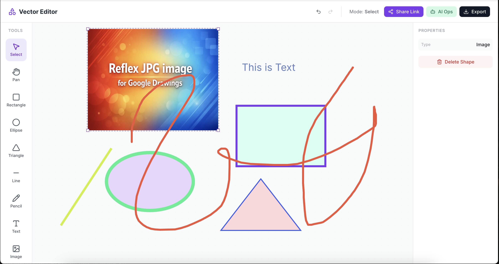

# Codoc in Vecdraw

A collaborative vector editor similar to Google Drawings, built with [Reflex](https://reflex.dev/).

## Overview

Codoc in Vecdraw brings the power of vector graphic editing to the web with a focus on simplicity and collaboration. Whether you are brainstorming ideas, creating technical diagrams, or just doodling, Codoc provides a shared space for creativity.

For a deeper dive into the system design and architecture, see the design document: [Codoc in Vecdraw Project Design & Architecture Overview](docs/Codoc%20in%20Vecdraw%20Project%20Design%20%26%20Architecture%20Overview.pdf).

### Application Interface

*A clean, intuitive interface with essential vector tools including rectangles, ellipses, lines, text, and freehand drawing.*

### Real-time Collaboration

*Share your workspace instantly via a room link and collaborate with others in real-time.*

### Feature Demo
[](https://www.youtube.com/watch?v=qPKxzscEXRo)

## Features

- **Vector Drawing**: Create and manipulate shapes on an infinite canvas.
- **Document Manager**: The home page lists every saved drawing (with a preview), with search, filters and delete. Each drawing lives at `/doc/<doc_id>` and is saved automatically.
- **Real-time Collaboration**: Everyone who opens the same `/doc/<doc_id>` link edits that drawing together.
- **AI Operations**: Control the canvas using JSON commands or via MCP (Model Context Protocol).
- **Interactive UI**: Toolbar for selecting tools and a properties panel for adjusting shape attributes.

## Prerequisites

- Python 3.11 – 3.15 (Reflex 0.10 requires Python 3.11 or newer)
- [Poetry](https://python-poetry.org/) for dependency management

## Installation

1. Clone the repository:
   ```bash
   git clone https://github.com/milochen0418/codoc_in_vecdraw.git
   cd codoc_in_vecdraw
   ```

2. Install dependencies:
   ```bash
   poetry install
   ```

3. Create the documents database (SQLite file `reflex.db`, schema managed by the migrations in `alembic/`):
   ```bash
   poetry run reflex db migrate
   ```

## Running the Application

Start the development server (`reflex_rerun.sh` also applies pending database migrations first):

```bash
poetry run ./reflex_rerun.sh
```

The application will be available at [http://localhost:3000](http://localhost:3000).

## Documents and Collaboration

- **Home page (`/`)** is the document manager: click **New Document** to start a drawing, or open an existing one from the list. Search matches the title, text inside the drawing and the doc ID.
- **Each drawing has its own URL**, `/doc/<doc_id>`. Changes are saved automatically; rename a drawing by editing its title in the top bar.
- **To co-edit**, click **Copy Link** in the editor and open the link in another browser: both see each other's changes in real time.
- Older share links of the form `/?room=<id>` open the drawing `/doc/<id>`.

## Testing

This project uses [Playwright](https://playwright.dev/python/) for end-to-end testing.

### Prerequisites

Install Playwright browsers:

```bash
poetry run playwright install
```

## MCP Server Integration

This project includes an MCP (Model Context Protocol) server that allows AI assistants (like Claude Desktop or ChatGPT Atlas) to control the canvas.

### Setup

1. Ensure the Reflex app is running (`poetry run reflex run`).
2. Run the MCP server:
   ```bash
   poetry run python mcp_server.py
   ```
   
   *Note: This runs the MCP server over stdio, which is suitable for integration with local AI clients.*

### Capabilities

The MCP server exposes tools to:
- Draw rectangles, circles, lines, and text.
- Clear the canvas.
- Target a drawing via `doc_id` (the id in `/doc/<doc_id>`, default `default`). The drawing must be open in a browser for the operations to be applied.

### Running Tests

We provide a helper script `run_test_suite.sh` that handles the server lifecycle (starts the server in the background, runs the test, and cleans up afterwards).

To run the default test (image upload debug):

```bash
bash run_test_suite.sh
```

To run a specific test case:

```bash
bash run_test_suite.sh debug_image/run_test.py
bash run_test_suite.sh doc_manager/run_test.py
```

The tests run headless; set `HEADLESS=0` to watch the browser, and `BASE_URL` to test a server on another address. Each test works on its own document and deletes it when it finishes.

### Adding New Test Cases

Test cases are located in the `testcases/` directory. To add a new test case:

1. Create a new directory under `testcases/` (e.g., `testcases/my_feature/`).
2. Create a Python script (e.g., `run_test.py`) inside that directory.
3. Use the `run_test_suite.sh` script to execute it:

```bash
bash run_test_suite.sh my_feature/run_test.py
```
