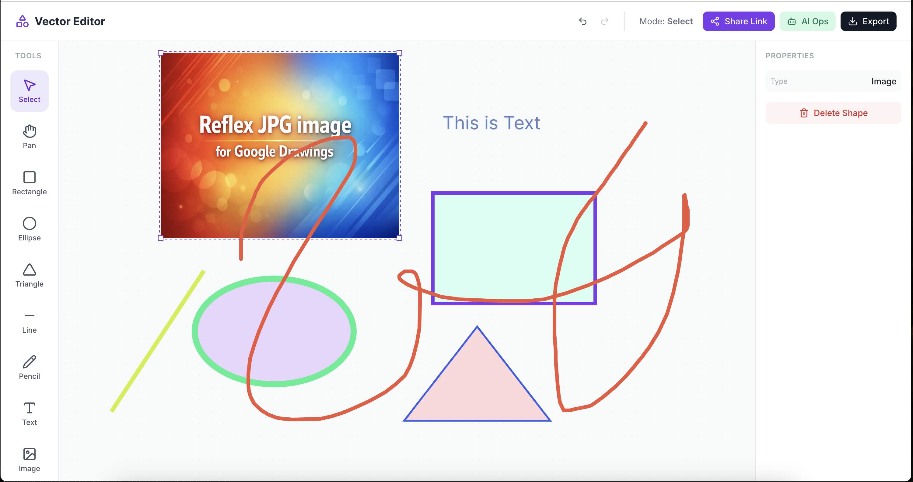

# Codoc in Vecdraw

A collaborative vector editor similar to Google Drawings, built with [Reflex](https://reflex.dev/).

## Overview

Codoc in Vecdraw brings the power of vector graphic editing to the web with a focus on simplicity and collaboration. Whether you are brainstorming ideas, creating technical diagrams, or just doodling, Codoc provides a shared space for creativity.

For a deeper dive into the system design and architecture, see the design document: [Codoc in Vecdraw Project Design & Architecture Overview](docs/Codoc%20in%20Vecdraw%20Project%20Design%20%26%20Architecture%20Overview.pdf).

### Application Interface

*A clean, intuitive interface with essential vector tools including rectangles, ellipses, lines, text, and freehand drawing.*

### Real-time Collaboration

*Share your workspace instantly via a room link and collaborate with others in real-time.*

### Feature Demo
[](https://www.youtube.com/watch?v=qPKxzscEXRo)

## Features

- **Vector Drawing**: Create and manipulate shapes on an infinite canvas.
- **Document Manager**: The home page lists every saved drawing (with a preview, who made it and who is on it now), with search, filters and delete. Each drawing lives at `/doc/<doc_id>` and is saved automatically.
- **Real-time Collaboration**: Everyone who opens the same `/doc/<doc_id>` link edits that drawing together: see each other's pointers, selections and shapes in progress, see who is here, and call everyone.
- **AI Operations**: Control the canvas using JSON commands or via MCP (Model Context Protocol).
- **Interactive UI**: Toolbar for selecting tools and a properties panel for adjusting shape attributes.

## Prerequisites

- Python 3.11 – 3.15 (Reflex 0.10 requires Python 3.11 or newer)
- [Poetry](https://python-poetry.org/) for dependency management

## Installation

1. Clone the repository:
   ```bash
   git clone https://github.com/milochen0418/codoc_in_vecdraw.git
   cd codoc_in_vecdraw
   ```

2. Install dependencies:
   ```bash
   poetry install
   ```

3. Create the documents database (SQLite file `reflex.db`, schema managed by the migrations in `alembic/`):
   ```bash
   poetry run reflex db migrate
   ```

## Running the Application

Start the development server (`reflex_rerun.sh` also applies pending database migrations first):

```bash
poetry run ./reflex_rerun.sh
```

The application will be available at [http://localhost:3000](http://localhost:3000).

## Documents and Collaboration

- **Home page (`/`)** is the document manager: click **New Document** to start a drawing, or open an existing one from the list. Search matches the title, text inside the drawing and the doc ID.
- **Each drawing has its own URL**, `/doc/<doc_id>`. Changes are saved automatically; rename a drawing by editing its title in the top bar.
- **To co-edit**, click **Copy Link** in the editor and open the link in another browser: both see each other's changes in real time.
- Older share links of the form `/?room=<id>` open the drawing `/doc/<id>`.

### What is shared, and what is yours

| | What | Who sees it |
|---|---|---|
| **The drawing** | the shapes, their order and properties, the title | everyone, and it is saved |
| **What you are doing** | your pointer with your name, what you selected, the shape you are dragging or drawing | the others, as a hint in your colour; nothing of it is saved |
| **What is yours** | your tool, the part of the canvas in view, your selection handles, your panels and dialogs, your Undo | only you |

So nobody's tool or view moves because of someone else, and **Undo** takes back your own changes, never theirs. A shape you drag or draw changes the drawing when you let go; until then the others watch it move, and **Esc** puts it back. Moving your view is private, so people out of view show as a chip at the edge of the canvas; click a chip, or someone's face at the top, to go to where they are.

**Call everyone** rings everyone on the drawing, through a call app installed from the App Store (the DDNS Intent `call.join`); without one the button does nothing.

### How it works

Reflex draws the page around the canvas (title, people, calls, the document manager). The tools, canvas and properties are a React component (`assets/vecdraw/`) that works in the browser, so your own drawing never waits for the network.

- The drawing is a Yjs document (`assets/vecdraw/doc.js`), kept by the server too (`codoc_in_vecdraw/yjs_ws.py`): changes merge, also those made while disconnected, and they keep working across a server restart because the document is stored with its edit history.
- What you are doing travels in the document's awareness, which nobody saves.
- `EditorState` (a Reflex `SharedState`) holds what the page shows to all: the title, the people, the call.

### Where drawings are saved

A drawing reaches the store about 1.5 seconds after a change (`codoc_in_vecdraw/saving.py`).

- **Run locally**, drawings are rows of the SQLite database `reflex.db`, and images are files in `uploaded_files/`.
- **Installed from the re_ddns App Store**, the catalog gives the app the shared collection `drawings`, and each drawing is an item of it (kind `drawing.vector`) that the App Store's **Storage** page lists: `drawing.json` (the shapes), `drawing.svg` (the same picture), `drawing.yjs` (the document with its edit history), `images/` (images placed in it), and a PNG as its preview. The title and the creator are in the item's manifest.

## Testing

This project uses [Playwright](https://playwright.dev/python/) for end-to-end testing.

### Prerequisites

Install Playwright browsers:

```bash
poetry run playwright install
```

## AI Assistant

On re_ddns with an AI Hub, **AI Assistant** in the top bar opens the hub's assistant on the drawing: tell it what to draw and it appears for everyone on the drawing. New shapes go in the part of the canvas in view, and "this" means the selected shape. The tools are in `codoc_in_vecdraw/ai_tools.py` (`vecdraw.*`). Adding shapes runs at once. Changing or removing them waits for your Accept in the chat, because Undo doesn't reach what the AI did.

## MCP Server Integration

This project includes an MCP (Model Context Protocol) server that allows AI assistants (like Claude Desktop or ChatGPT Atlas) to control the canvas.

### Setup

1. Ensure the Reflex app is running (`poetry run reflex run`).
2. Run the MCP server:
   ```bash
   poetry run python mcp_server.py
   ```
   
   *Note: This runs the MCP server over stdio, which is suitable for integration with local AI clients.*

### Capabilities

The MCP server exposes tools to:
- Draw rectangles, circles, lines, and text.
- Clear the canvas.
- Target a drawing via `doc_id` (the id in `/doc/<doc_id>`, default `default`). The operations reach everyone on the drawing at once, and work with no browser open too.

### Running Tests

We provide a helper script `run_test_suite.sh` that handles the server lifecycle (starts the server in the background, runs the test, and cleans up afterwards).

To run the default test (image upload debug):

```bash
bash run_test_suite.sh
```

To run a specific test case:

```bash
bash run_test_suite.sh debug_image/run_test.py
bash run_test_suite.sh doc_manager/run_test.py
```

Besides the document manager and the debug suites, `together/run_test.py` is two people on one drawing: what is shared, what is each person's own, and what each sees of the other. `poetry run pytest` runs the unit tests in `tests/`.

The tests run headless; set `HEADLESS=0` to watch the browser, and `BASE_URL` to test a server on another address (`BACKEND_URL` as well for `together`). Each test works on its own document and deletes it when it finishes.

### Adding New Test Cases

Test cases are located in the `testcases/` directory. To add a new test case:

1. Create a new directory under `testcases/` (e.g., `testcases/my_feature/`).
2. Create a Python script (e.g., `run_test.py`) inside that directory.
3. Use the `run_test_suite.sh` script to execute it:

```bash
bash run_test_suite.sh my_feature/run_test.py
```
