<h1 align="center">Codoc in VecDraw</h1>

<p align="center">
  <b>One picture. Always the latest.</b><br>
  A vector editor you draw in together, on your own machine. Send a link instead of a screenshot, and the picture in your chat and in your documents follows the drawing.
</p>

<p align="center">
  <!-- FILM: when the film is on YouTube, put <a href="https://youtu.be/ID"><b>▶ Watch the film</b></a> · here -->
  <a href="https://vecdraw.reflex-ddns.com"><b>Open it</b></a> ·
  <a href="#install-it-from-the-agentic-app-store"><b>Install it</b></a> ·
  <a href="#why-codoc-in-vecdraw">Why</a> ·
  <a href="#what-you-get">What you get</a> ·
  <a href="#a-tour">Tour</a> ·
  <a href="#run-it-from-source">Run from source</a>
</p>

<p align="center">
  <a href="LICENSE"></a>
  
  
  <a href="https://milochen0418.github.io/re_ddns/"></a>
</p>

<p align="center">
  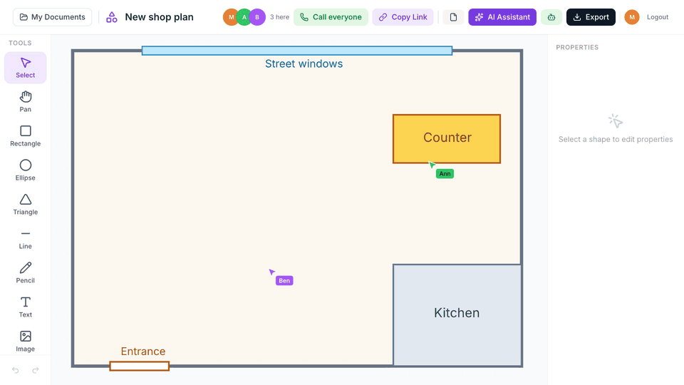
</p>

## Why Codoc in VecDraw

Every team has a `plan-v3-final.png`. A picture leaves the drawing tool as a file, lands in a chat and in a document, and is out of date the next time someone changes the drawing. Then someone has to ask which one is the latest.

Here a drawing is a place with a link. Everyone who opens the link is on the same picture. A card in a chat and a frame in a document show that picture too, not a copy of it, so there is only ever one latest version.

## What you get

| | |
|---|---|
| **One link** | Open it and you are on the drawing. No account needed. |
| **Draw together** | Shapes, lines, freehand, text and images on a canvas with no edges. Everyone's pointer and selection show with their name. |
| **Your own tools** | Your tool, your view and your Undo stay yours. Nobody's work moves under your hands. |
| **AI that draws** | Tell the AI Hub's assistant what to draw, on a model running on your own machine if you like. Everyone sees it arrive. |
| **A card in the chat** | Paste the link in [Relack](https://github.com/milochen0418/relack) and it shows the title and a picture. The picture follows the drawing, even in old messages. |
| **A live picture in documents** | One line in [CoDoc in MD](https://github.com/milochen0418/codoc_in_md) puts the drawing in a document. It is read only, and it changes when the drawing changes. |
| **Call everyone** | One button rings everyone on the drawing. |
| **Your own files** | Every drawing is a folder of plain files on your machine. Export JSON, SVG or PNG whenever you like. |

## Install it from the Agentic App Store

The quickest way to run it is the [Agentic App Store](https://milochen0418.github.io/re_ddns/): an open-source store that runs on your own computer and installs apps from GitHub with one click.

1. Get the store. It needs Docker on a Mac or Linux host; [one script](https://github.com/milochen0418/re_ddns#quick-start-run-from-zero) sets up everything:
   ```bash
   git clone https://github.com/milochen0418/re_ddns.git
   cd re_ddns
   ./rerun_from_zero.sh
   ```
2. Open `https://aapps.reflex-ddns.com`, find **Codoc in VecDraw** and press **Install**.
3. Watch the progress bar, then press **Open**. The app is at `https://vecdraw.reflex-ddns.com`, and the other computers on your network [join with one script](https://github.com/milochen0418/re_ddns#quick-start-run-from-zero).

Installed this way, it finds the store's other apps by itself: the AI Hub for the assistant, a call app for **Call everyone**, Relack for the cards and CoDoc in MD for documents. None of them is required.

## A tour

The pictures below are real screens of the live apps, as Mia, Ann and Ben plan a made-up coffee shop.

### One link, one drawing

**Copy Link** in the top bar gives the drawing's address. Paste it in a Relack room and the message gets a card with the drawing's title, the words on it and its picture. Whoever opens it is on the drawing, signed in or not.

<p align="center">
  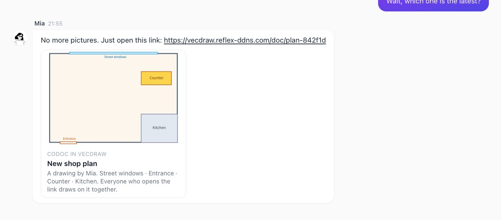
</p>

The picture on a card is the drawing as it is when the card loads, so an old message never shows an old drawing:

<p align="center">
  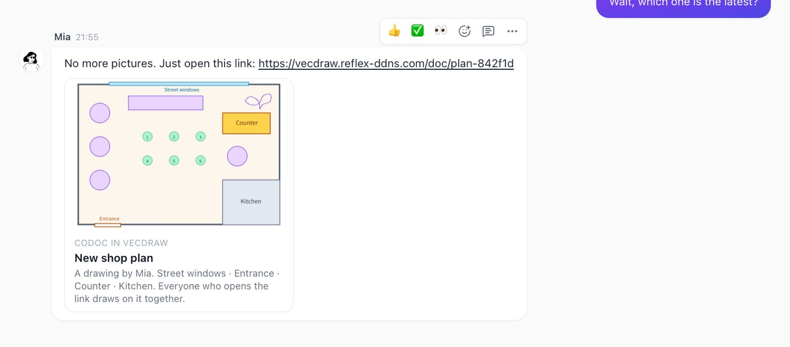
</p>

### Together, and each on your own

Everyone sees the same shapes, each person's pointer with a name, and what they selected. A shape someone is dragging or drawing shows as a hint in their colour, and it becomes part of the drawing when they let go, so nothing half done is saved and **Esc** puts it back.

<p align="center">
  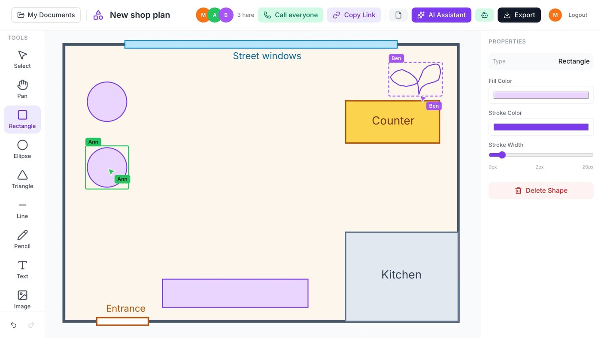
</p>

Your tool, the part of the canvas in view and your **Undo** are yours. In the picture below Ben has just pressed Undo: his rectangle is gone from both screens, and the table Ann drew at the same moment is still there.

<p align="center">
  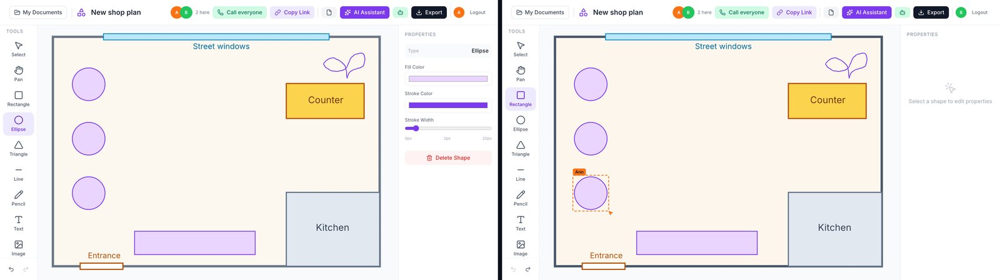
</p>

Moving your view is private too. People out of view show as a chip at the edge of the canvas; click a chip, or someone's face at the top, to go to where they are.

### Tell the AI what to draw

With the [AI Hub](https://github.com/milochen0418/ai_hub) installed, **AI Assistant** opens its assistant on the drawing. It reads what is there, draws, looks at the result, and everyone sees the shapes arrive. Here it ran on a local Ollama model, and the AI shows among the people on the drawing while it works.

<table>
  <tr>
    <td>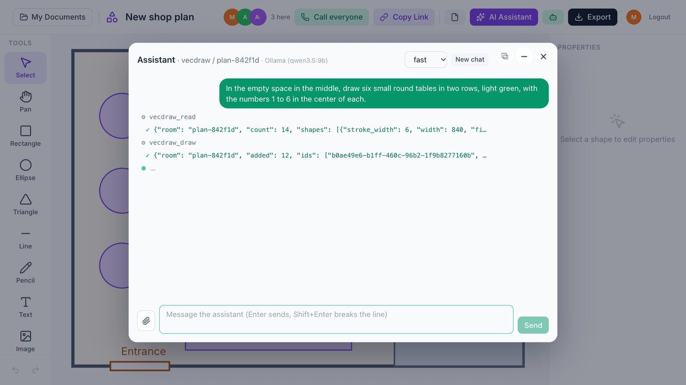</td>
    <td>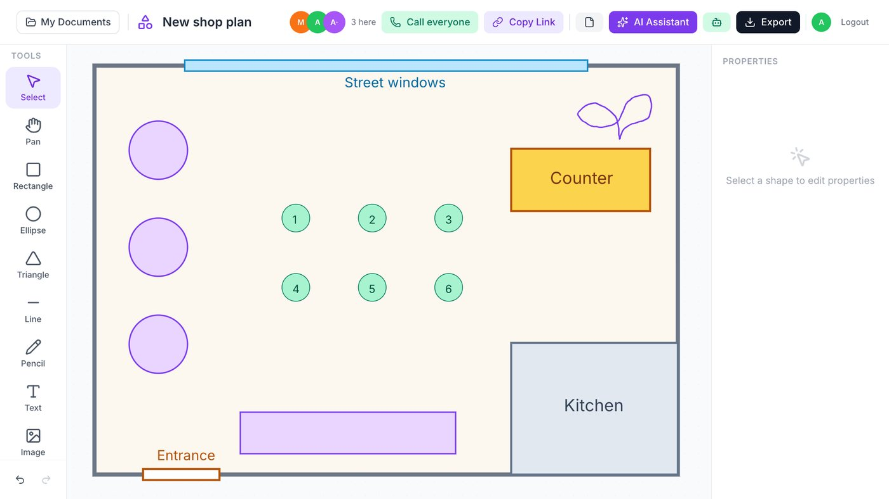</td>
  </tr>
</table>

New shapes go in the part of the canvas in view, and "this" means the selected shape. Adding runs at once. Changing or removing shapes waits for your **Accept** in the chat, because Undo doesn't reach what the AI did. Local models get it wrong often enough that you should look at the result: in our runs the same request gave a clean plan some of the time and tables on top of each other at other times.

### In a document

In [CoDoc in MD](https://github.com/milochen0418/codoc_in_md), one line shows a drawing, by its id or its link:

```


```

<p align="center">
  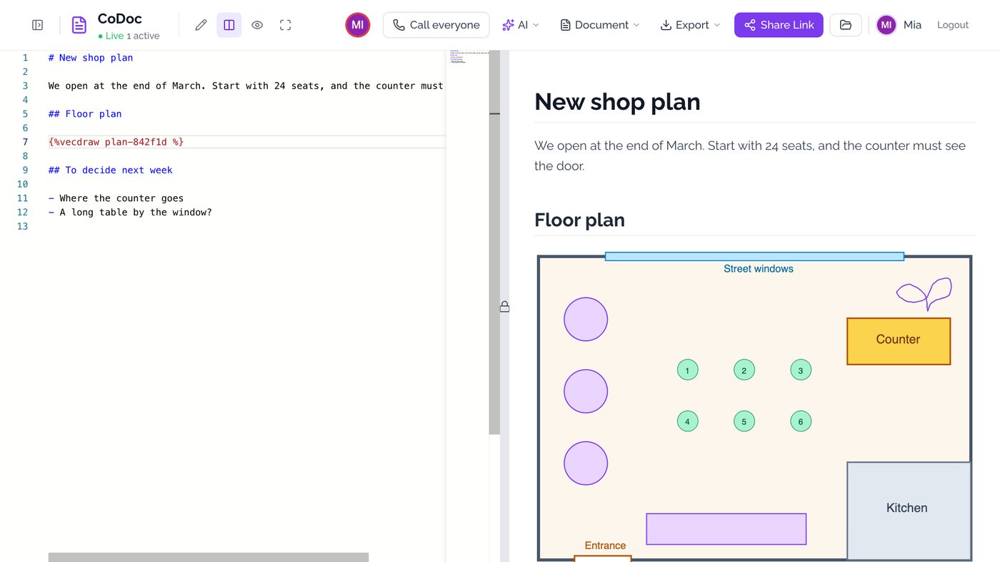
</p>

It isn't a screenshot. Ben moves a table on the left, and the document on the right follows a moment later, with no reload:

<p align="center">
  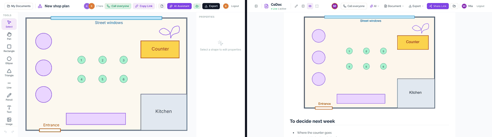
</p>

In the document the drawing is read only, and it holds no way to the editor: to change the picture, open the drawing. Printing and **Export as PDF** show a picture of it as it is then.

### Call everyone

**Call everyone** rings everyone on the drawing and opens the call beside it, through a call app from the App Store (the DDNS Intent `call.join`). Without one, the button does nothing.

<p align="center">
  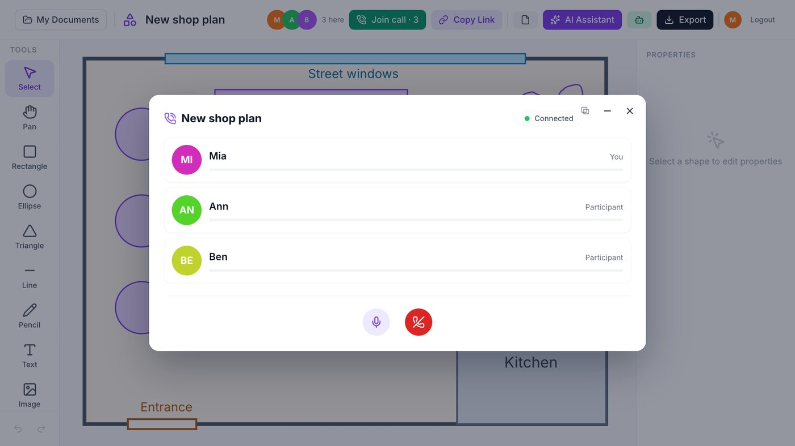
</p>

### Your own files

Installed from the App Store, every drawing is a folder in the shared collection `drawings`, on your disk, and the store's **Storage** page lists them. **Export** in the top bar gives JSON, SVG or PNG.

<p align="center">
  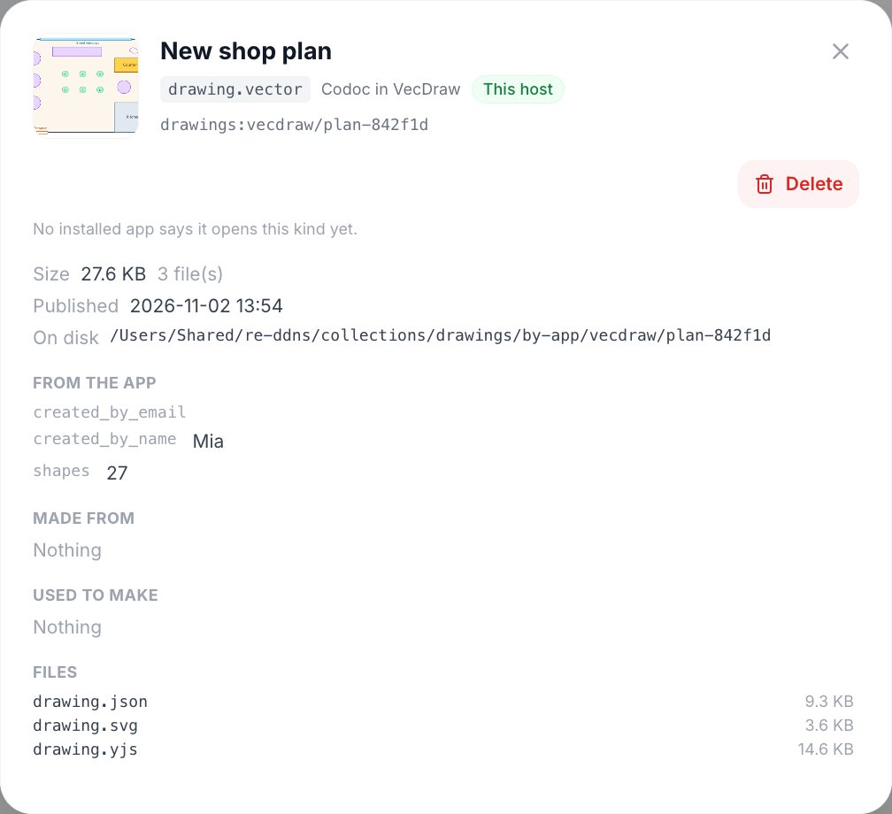
</p>

## What is shared, and what is yours

| | What | Who sees it |
|---|---|---|
| **The drawing** | the shapes, their order and properties, the title | everyone, and it is saved |
| **What you are doing** | your pointer with your name, what you selected, the shape you are dragging or drawing | the others, as a hint in your colour; nothing of it is saved |
| **What is yours** | your tool, the part of the canvas in view, your selection handles, your panels and dialogs, your Undo | only you |

## Not there yet

- **Permissions.** There are none: anyone who can reach the app can open, change or delete any drawing, and the list shows everyone's. Signing in only gives you a name. Keep it on a network you trust.
- **Drawing tools.** No zoom, rotation, grouping or selecting several shapes at once. No arrowheads, snapping or alignment guides, and no way to bring a shape to the front. Text comes in one font.
- **History.** Undo covers your own changes in this tab. There is no version history, and it can't take back what the AI did.
- **The card's words.** The picture on a card follows the drawing; its title and words stay as they were when the message was sent.
- **Phones.** The tools fold down on a small screen, but nobody has tested drawing on a phone. On re_ddns each device also needs the host's DNS setting and certificate, so colleagues have to be able to reach your machine.

## Run it from source

This project is managed with [Poetry](https://python-poetry.org/), on Python 3.11 – 3.15 (Reflex 0.10 requires 3.11 or newer).

1. Clone it, with [reflex_ddns_auth](https://github.com/milochen0418/reflex_ddns_auth) beside it:
   ```bash
   git clone https://github.com/milochen0418/reflex_ddns_auth.git
   git clone https://github.com/milochen0418/codoc_in_vecdraw.git
   cd codoc_in_vecdraw
   ```
2. Install the dependencies:
   ```bash
   poetry install
   ```
3. Create the documents database (SQLite file `reflex.db`, schema managed by the migrations in `alembic/`):
   ```bash
   poetry run reflex db migrate
   ```
4. Start it (`reflex_rerun.sh` also applies pending migrations first):
   ```bash
   poetry run ./reflex_rerun.sh
   ```

The app is at [http://localhost:3000](http://localhost:3000). **New Document** on the home page starts a drawing; older share links of the form `/?room=<id>` open the drawing `/doc/<id>`.

## How it works

Reflex draws the page around the canvas (title, people, calls, the document manager). The tools, canvas and properties are a React component (`assets/vecdraw/`) that works in the browser, so your own drawing never waits for the network.

- The drawing is a Yjs document (`assets/vecdraw/doc.js`), kept by the server too (`codoc_in_vecdraw/yjs_ws.py`): changes merge, also those made while disconnected, and they keep working across a server restart because the document is stored with its edit history.
- What you are doing travels in the document's awareness, which nobody saves.
- `EditorState` (a Reflex `SharedState`) holds what the page shows to all: the title, the people, the call.

For a deeper dive, see the [design and architecture overview](docs/Codoc%20in%20Vecdraw%20Project%20Design%20%26%20Architecture%20Overview.pdf) (from before the Yjs rebuild).

### Where drawings are saved

A drawing reaches the store about 1.5 seconds after a change (`codoc_in_vecdraw/saving.py`).

- **Run locally**, drawings are rows of the SQLite database `reflex.db`, and images are files in `uploaded_files/`.
- **Installed from the re_ddns App Store**, the catalog gives the app the shared collection `drawings`, and each drawing is an item of it (kind `drawing.vector`): `drawing.json` (the shapes), `drawing.svg` (the same picture), `drawing.yjs` (the document with its edit history), `images/` (images placed in it), and a PNG as its preview. The title and the creator are in the item's manifest.

### Pictures for other apps

A drawing's page is the same for every drawing, so what other apps show comes from the backend, under `/_vecdraw/`. None of these makes a drawing: an address that leads nowhere stays one.

| Address | What it is |
|---|---|
| `/_vecdraw/og/<id>` | Open Graph tags for chat apps, which then send people on to `/doc/<id>` (`codoc_in_vecdraw/link_preview.py`). Relack reads this instead of `/doc/<id>` for the hosts in `RELACK_VECDRAW_HOSTS`. |
| `/_vecdraw/og/<id>/image.png` | The drawing as it is now, 900×600. |
| `/_vecdraw/embed/<id>` | The drawing to look at on another page: a small page, not a Reflex page, with nothing to draw with (`codoc_in_vecdraw/embed.py`). It joins nobody to the drawing. It tells the page around it its shape with the message `{type: "vecdraw-embed", ratio}`. |
| `/_vecdraw/embed/<id>/live` | The websocket that page uses to get the picture again when the drawing changes. |

Pictures made on the server use Pillow, with a font that has Chinese in it (`apt-packages.txt` installs one in the container). Without one, text in other alphabets shows as a grey bar in those pictures.

## AI

**AI Assistant** needs the platform's AI Hub. The tools are in `codoc_in_vecdraw/ai_tools.py` (`vecdraw.*`).

This project also includes an MCP (Model Context Protocol) server that lets AI clients such as Claude Desktop control the canvas directly:

1. Ensure the Reflex app is running (`poetry run reflex run`).
2. Run the MCP server, which uses stdio:
   ```bash
   poetry run python mcp_server.py
   ```

Its tools draw rectangles, circles, lines and text, clear the canvas, and target a drawing via `doc_id` (the id in `/doc/<doc_id>`, default `default`). The operations reach everyone on the drawing at once, and work with no browser open too.

**AI Ops** in the top bar takes the same operations as JSON.

## Testing

End-to-end tests use [Playwright](https://playwright.dev/python/):

```bash
poetry run playwright install
```

`run_test_suite.sh` handles the server lifecycle: it starts the server in the background, runs the test and cleans up afterwards.

```bash
bash run_test_suite.sh                         # the default test (image upload debug)
bash run_test_suite.sh doc_manager/run_test.py
bash run_test_suite.sh together/run_test.py    # two people on one drawing
bash run_test_suite.sh embed_view/run_test.py  # the link's card, and a drawing on another page
```

`poetry run pytest` runs the unit tests in `tests/`.

The tests run headless; set `HEADLESS=0` to watch the browser, and `BASE_URL` to test a server on another address (`BACKEND_URL` as well for `together`). Each test works on its own document and deletes it when it finishes.

To add a test case, create a directory under `testcases/` (e.g. `testcases/my_feature/`) with a `run_test.py`, and run it with `bash run_test_suite.sh my_feature/run_test.py`.

## Licence

[MIT](LICENSE). An [earlier feature demo](https://www.youtube.com/watch?v=qPKxzscEXRo) shows the app from before the rebuild.
